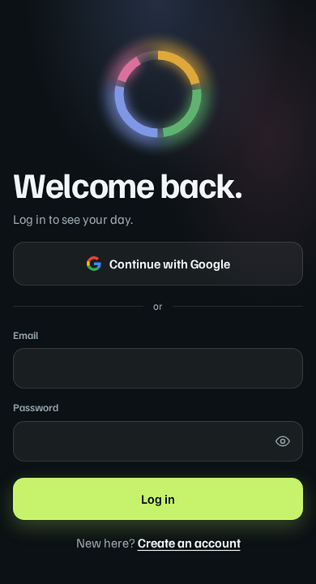
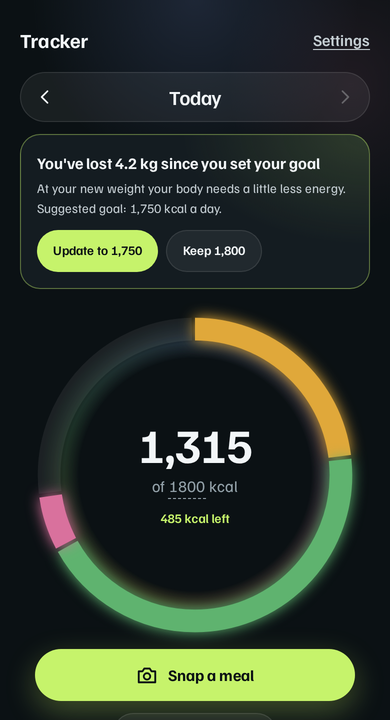
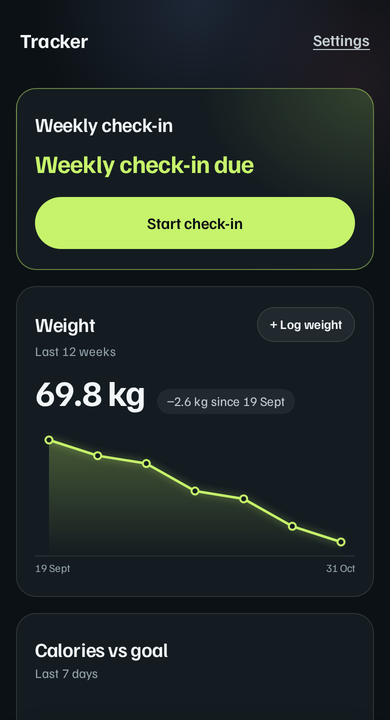
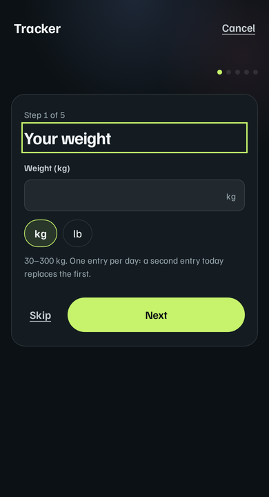
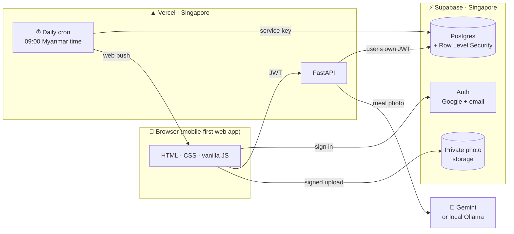
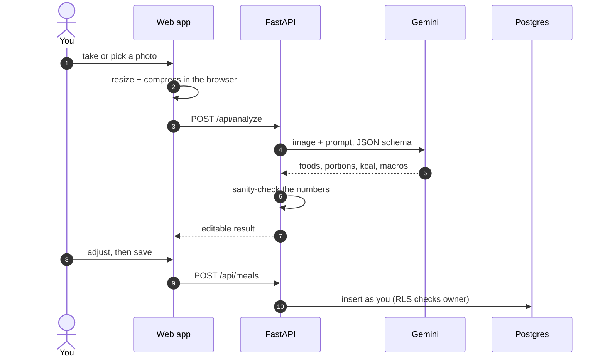
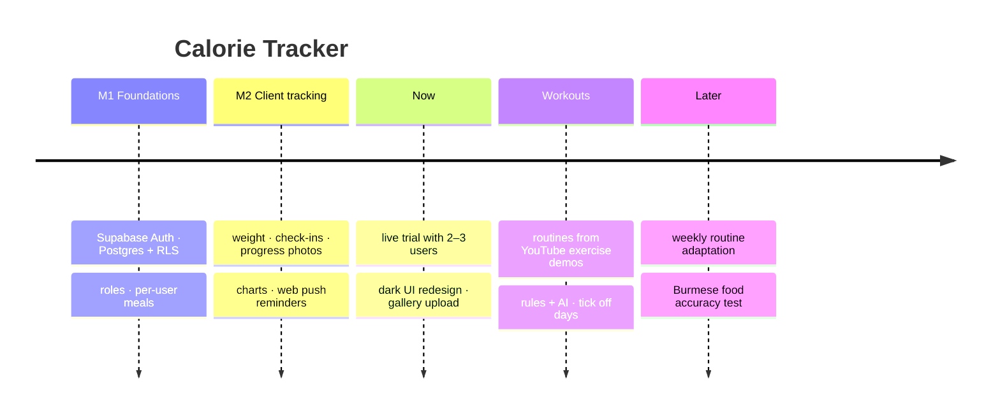

<div align="center">


<a href="https://github.com/htetmyet19/calorie-tracker">
  
</a>

<p>
  <a href="https://calorie-tracker-indol-theta.vercel.app"></a>
  
  
</p>

<p>
  
  
  
  
  
  
  
  
</p>

[Screens](#-screens) · [Features](#-features) · [How it works](#-how-it-works) · [Security](#-security-and-privacy) · [Run it](#-run-it-locally) · [Roadmap](#%EF%B8%8F-roadmap)

</div>

---

## 📱 Screens

<div align="center">
<table>
<tr>
<td align="center"><br><sub><b>Sign in</b><br>Google or email</sub></td>
<td align="center"><br><sub><b>Today</b><br>calorie ring by meal</sub></td>
<td align="center"><br><sub><b>Progress</b><br>weight trend + check-ins</sub></td>
<td align="center"><br><sub><b>Weekly check-in</b><br>5 quick steps</sub></td>
</tr>
</table>
<sub>Mobile-first dark UI with a lime accent · screenshots use a demo account</sub>
</div>

## ✨ Features

<table>
<tr>
<td width="33%" valign="top">

#### 📸 Snap a meal
Take a photo or pick one from the gallery. A vision model names each food, estimates the portion and calories, and you can edit everything before saving.

</td>
<td width="33%" valign="top">

#### 🍩 Your day at a glance
A ring shows calories eaten against your goal as a gradient that runs from green through yellow to red past the goal, so the tip shows where you are. Under the number, the zone is named: green while there's room (under 85%), yellow near the goal, red once over it. Weight-gain goals stay green up to 110% and turn red only past 125%. The zone is also named in words. The split into breakfast, lunch, dinner and snacks is listed below the ring, with protein, carbs and fat.

Under the ring, Coach Ollie (an otter) says one short thing about today: check-in day, a nudge to log the first meal, or how much room is left, worded for your goal and never shaming when you're over. The lines are fixed copy picked by rules, not AI. He lives in the bottom-right corner as a full-body otter who goes through a mix of moves that fits your day, about ten seconds each: running, stretching, jumping jacks, yoga and push-ups when you're on track; yoga and stretching when you're over (calm, never a telling-off) or in the evening; sleeping at night; waving on check-in day. He eats sushi right after you log a meal. A tap makes him cheer; his message is a cream speech bubble above him that opens for each new line; tap the bubble to fold it away (tap him to open it again or to get another line). Settings › Show coach turns him off on that device. On phones the Today page fits one screen: only the meals list scrolls. It shows only on today, not past days.

</td>
<td width="33%" valign="top">

#### 🎯 A goal that keeps up
A calculator sets your daily goal from height, weight, age, sex and activity. After a 2 kg change it suggests an updated goal, and you choose whether to use it.

</td>
</tr>
<tr>
<td valign="top">

#### 📈 Progress
Weight in kg or lb with a 12-week chart, calories vs goal for the last 7 days, and a timeline of check-ins you can compare side by side.

</td>
<td valign="top">

#### 🗓️ Weekly check-ins
Weight plus optional front, side and back photos. If a check-in is due, a web push reminder arrives (at most two per check-in).

</td>
<td valign="top">

#### 🔐 Private by design
Each user only sees their own data, enforced by Postgres Row Level Security, not just the API. Meal photos are deleted after 90 days.

</td>
</tr>
<tr>
<td valign="top" colspan="3">

#### 💬 Advice on each meal
As soon as a photo is estimated, a short suggestion shows how the meal fits your day, with one practical tip. A single meal over 40% of your daily goal (say, eight pieces of fried chicken at lunch) gets portion tips even when the day still has room; weight-gain goals are left out. If you edit the items, tap "Update suggestion" to get a new one. The AI writes it from numbers the server works out; the text is checked (no "don't eat"/"skip"/shaming words, no links, every kcal figure must match) and a plain fixed message is shown instead if it fails. Advice is never stored, and requests are limited to 30 a day.

#### 🏋️ Workout routines
Pick days per week, experience, equipment and session length, and get a weekly routine built from a curated library of YouTube exercise demos. Rules keep every exercise within your level, equipment and time; an AI picks and orders exercises for your goal, and if it fails or breaks a rule the rules-only routine is used. Tick off each day as you go. A safety question comes first: anyone with an injury or condition is asked to check with a doctor or physiotherapist instead.

</td>
</tr>
</table>

## 🧠 How it works



<details>
<summary><b>📸 What happens when you snap a meal</b></summary>



If the main Gemini model is overloaded or out of quota, the backend retries and then falls back to other models.

</details>

## 🔒 Security and privacy

- **Row Level Security everywhere.** The API talks to Postgres with *the user's own* token, so the database itself refuses access to anyone else's meals, weights or photos.
- **Private photo buckets.** Photos are stored per user and served only through signed access.
- **The service-role key never reaches the browser.** Only the daily job (`app/cron.py`) may read it, and a unit test enforces that.
- **Data minimisation.** No phone number, national ID or location is collected.
- **Tested at two layers.** 389 unit tests and 156 frontend tests run without a database; 84 integration tests run against a real local Supabase and check that one user cannot read another's data.

## 🚀 Run it locally

<details>
<summary><b>Quick start</b></summary>

```bash
cd backend
python -m venv .venv && .venv/bin/pip install -r requirements-dev.txt
cp .env.example .env            # fill in Supabase + model settings
npx supabase@2 start            # local Supabase (Docker), applies migrations
.venv/bin/uvicorn app.main:app --reload
```

Open <http://localhost:8000>. Run the tests with:

```bash
.venv/bin/pytest                       # unit
.venv/bin/pytest -m integration        # needs the local Supabase stack
node --test "tests/*.test.js"          # frontend helpers
```

**Workout videos.** The library is `backend/data/exercise_videos.json` (one entry per exercise demo: `youtube_id`, `title`, `channel`, `category`, `level`, `equipment`, `duration_sec`). Watch and approve every video before adding it, then:

```bash
.venv/bin/python scripts/sync_videos.py           # check labels, dead links and gaps
.venv/bin/python scripts/sync_videos.py --apply   # write to Supabase (service-role key)
```

</details>

Full setup (environment variables, hosted Supabase, cron and push keys, Ollama on WSL) is in **[`backend/README.md`](backend/README.md)**.

## 🗂️ Project structure

```text
calorie-tracker/
├── backend/
│   ├── app/                  FastAPI: routes, auth, storage, AI clients, cron
│   ├── static/               web app: Today, Progress, Workout, Check-in, Login (no build step)
│   ├── supabase/migrations/  schema + Row Level Security policies
│   └── tests/                pytest (unit + integration) and node tests
├── docs/superpowers/         design specs and implementation plans
└── mobile/                   early single-user Android app (not connected to the new login yet)
```

## 🛣️ Roadmap



- [x] **M1** — accounts, roles, per-user meals with Row Level Security
- [x] **M2** — weight, weekly check-ins, progress photos, charts, push reminders
- [ ] **Trial** — 2–3 real users on Android and iPhone
- [ ] **Accuracy check** — 20–30 Burmese meals with known calories (e.g. mohinga, laphet thoke), error reported
- [ ] **Workout routines** — built and tested; needs the first 40–60 curated videos before the trial

> **Honest note:** calorie estimates from a photo are approximate. Accuracy on Burmese dishes has not been measured yet; that test is on the roadmap before launch.

<div align="center">


</div>
